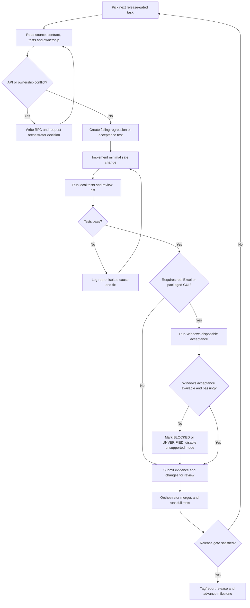
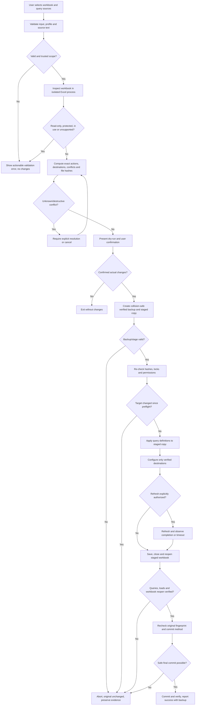

# Decision flows for agents and importer

These are operational flowcharts. Do not use them as substitutes for source code tests.

## Agent issue / implementation flow

## Workbook operation safety flow

**Important:** `Z` is not 'rollback succeeded' unless confirmed. If failure occurs after partial commit, record the exact persisted state and do not overwrite a possibly independently modified workbook. Cases that may evaluate M (load to sheet/model or refresh) should visibly disclose possible file/network/database access before execution.
